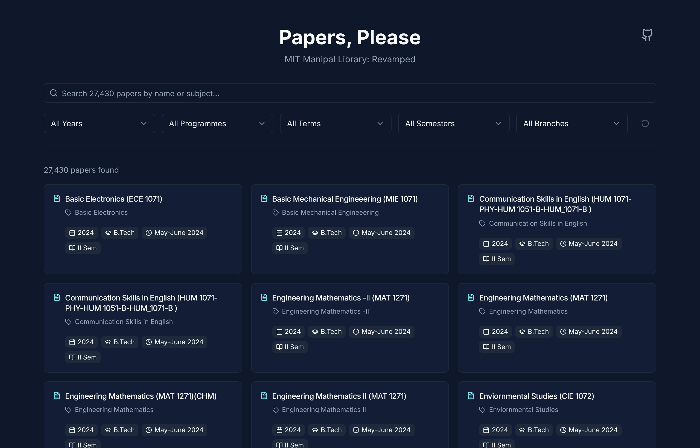

# Papers, Please

**A fast, filterable archive of MIT Manipal previous-year question papers.**

The official library portal stores tens of thousands of question papers as a deep tree of folders, which makes finding "the 2022 IV-semester CSE Data Structures paper" a lot of clicking. Papers, Please takes a scraped index of that portal, cleans it into structured records (year, term, programme, semester, branch, subject) and serves it through a single searchable page and a small JSON API. Every result links straight to the original PDF on the library portal.



## Features

- **Full-text search** over paper names and inferred subjects, debounced as you type.
- **Cascading filters** for year, programme, term, semester and branch. Each dropdown only lists values that still have results given your other selections, and changing a filter clears the narrower ones below it.
- **Server-side pagination** (24 per page), with the first page and filter options rendered on the server, so the page loads with results already there.
- **Sensible ordering**: newest year first, then term, programme, semester (numerically, so II comes before IV) and branch.
- **Data cleaning**: drops non-paper documents (library policies, membership forms and so on), collapses the many spellings of each branch (for example `Computer Science`, `computer science engg` → `CSE`), strips exam-type words and infers a subject from file names.
- **JSON API** for building other tools on top of the dataset.
- Loading, empty and error states (with retry); keyboard and screen-reader friendly; responsive down to phone widths; respects `prefers-reduced-motion`.

## Tech stack

| Area      | Choice                                                                    |
| --------- | ------------------------------------------------------------------------- |
| Framework | [Next.js 15](https://nextjs.org/) (App Router, route handlers)            |
| Language  | TypeScript (strict)                                                       |
| UI        | React 18, Tailwind CSS 3, [shadcn/ui](https://ui.shadcn.com/) on Radix UI |
| Motion    | Framer Motion                                                             |
| Testing   | Vitest                                                                    |
| Quality   | ESLint (`next/core-web-vitals`, `next/typescript`), Prettier              |
| Packaging | Docker (multi-stage, Next.js standalone output)                           |

## How it works

```
data/all_papers.json          scraped index: [{ path: [...folders], name, url }, …]
        │
        ▼
src/lib/papers/loader.ts      reads the file once per server process (cached promise)
        │
        ▼
src/lib/papers/metadata.ts    drops non-papers, derives year/term/programme/semester/
                              branch/subject from the folder path + file name, sorts
        │
        ▼
src/lib/papers/query.ts       pure functions: filter, search, paginate, faceted options
        │
        ├──► src/app/page.tsx                    server-renders page 1 + filter options
        ├──► src/app/api/papers/route.ts         GET /api/papers
        └──► src/app/api/filter-options/route.ts GET /api/filter-options
                                     ▲
src/components/PapersPleaseClient.tsx  client state; calls the API on every change,
                                       cancelling superseded requests
```

The dataset is static, so there is no database: about 70,000 raw entries are parsed into roughly 27,000 papers in memory when the server first needs them, and every query after that is an in-memory filter.

## Getting started

### Prerequisites

- Node.js **20.9 or newer**
- npm (a `package-lock.json` is committed)

### Install and run

```bash
npm install
npm run dev
```

Then open <http://localhost:3000>.

### Environment variables

None are required. To override the defaults, copy `.env.example` to `.env.local`:

| Variable               | Default                | Purpose                                                                      |
| ---------------------- | ---------------------- | ---------------------------------------------------------------------------- |
| `NEXT_PUBLIC_SITE_URL` | _(unset)_              | Public URL of the deployment, used for absolute URLs in Open Graph metadata. |
| `PAPERS_DATA_FILE`     | `data/all_papers.json` | Path to the dataset, absolute or relative to the working directory.          |
| `PORT`                 | `3000`                 | Port for `npm start` and the Docker image.                                   |

## Scripts

| Command             | What it does                                                |
| ------------------- | ----------------------------------------------------------- |
| `npm run dev`       | Start the dev server (Turbopack) with hot reload.           |
| `npm run build`     | Production build (standalone output in `.next/standalone`). |
| `npm start`         | Serve the production build.                                 |
| `npm test`          | Run the Vitest suite once (`npm run test:watch` to watch).  |
| `npm run lint`      | ESLint.                                                     |
| `npm run format`    | Format with Prettier (`format:check` to verify only).       |
| `npm run typecheck` | `tsc --noEmit`.                                             |
| `npm run check`     | Lint, format check, typecheck and tests together.           |

The tests cover the parts that hold the logic: path and file-name parsing, branch normalisation, the non-paper filter, sort orders, query parsing (including malformed input), filtering, search, pagination, faceted options and both API route handlers against a small fixture dataset.

## API

Both endpoints return JSON and accept `all` (or an empty value) for any filter to mean "no filter".

### `GET /api/papers`

Returns one page of papers matching the filters and search.

| Parameter                                         | Description                                                     |
| ------------------------------------------------- | --------------------------------------------------------------- |
| `year`, `programme`, `term`, `semester`, `branch` | Exact-match filters (optional).                                 |
| `search`                                          | Case-insensitive substring match on name or subject (optional). |
| `page`                                            | Page number, default `1`. Invalid values fall back to `1`.      |
| `pageSize`                                        | Results per page, default `24`, maximum `100`.                  |

```bash
curl 'http://localhost:3000/api/papers?year=2022&semester=IV%20Sem&search=data&pageSize=1'
```

```json
{
  "total": 22,
  "page": 1,
  "pageSize": 1,
  "totalPages": 22,
  "results": [
    {
      "year": "2022",
      "term": "Jun-Jul 2022",
      "name": "Database Systems (CSE 2251)",
      "programme": "B.Tech",
      "semester": "IV Sem",
      "branch": "CSE",
      "subject": "Database Systems",
      "path": ["2022", "Jun-Jul 2022", "B.Tech", "IV Sem", "CSE"],
      "url": "https://libportal.manipal.edu/RootFolder/2022/Jun-Jul%202022/B.Tech/IV%20Sem/CSE/Database%20Systems%20(CSE%202251)%20(Makeup).pdf",
      "id": "paper-24633"
    }
  ]
}
```

Counts and ids depend on the dataset; ids are only stable for a given version of `data/all_papers.json`.

### `GET /api/filter-options`

Returns the values available for one filter, given the other selected filters. The filter's own current value is ignored, so you can switch between siblings.

| Parameter                                         | Description                                                         |
| ------------------------------------------------- | ------------------------------------------------------------------- |
| `level`                                           | Required. One of `year`, `programme`, `term`, `semester`, `branch`. |
| `year`, `programme`, `term`, `semester`, `branch` | Current selections (optional).                                      |

```bash
curl 'http://localhost:3000/api/filter-options?level=semester&year=2022'
# {"options":["I Sem","II Sem","III Sem","IV Sem","V Sem","VI Sem","VII Sem"]}
```

An unknown or missing `level` returns `400`. A failure to load the dataset returns `500` with a generic message (details are logged on the server only).

## Deployment

### Docker

The `Dockerfile` builds the app and runs the Next.js standalone server as a non-root user. The dataset is copied into the image.

```bash
docker build -t papers-please .
docker run --rm -p 3000:3000 papers-please
```

### Any Node.js host

```bash
npm ci
npm run build
npm start            # or: node .next/standalone/server.js
```

When running the standalone server directly, copy `.next/static`, `public` and `data` next to it, as the Dockerfile does.

### Updating the data

Replace `data/all_papers.json` with a fresh export in the same shape (`[{ "path": string[], "name": string, "url": string }]`) and restart or redeploy. Entries that can't be parsed are skipped and counted in the server log.

## Project structure

```
.
├── data/all_papers.json         # scraped index of the library portal
├── public/                      # static assets (favicon)
├── src/
│   ├── app/
│   │   ├── api/
│   │   │   ├── papers/route.ts          # GET /api/papers
│   │   │   └── filter-options/route.ts  # GET /api/filter-options
│   │   ├── layout.tsx           # fonts, metadata, skip link
│   │   ├── page.tsx             # server-renders the first page
│   │   ├── loading.tsx / error.tsx / not-found.tsx
│   │   └── globals.css          # theme tokens
│   ├── components/
│   │   ├── PapersPleaseClient.tsx  # search, filters, results, pagination state
│   │   ├── Filters.tsx, PaperList.tsx, Pagination.tsx, PageShell.tsx, SiteHeader.tsx
│   │   └── ui/                  # shadcn/ui primitives
│   ├── hooks/useDebounce.ts
│   ├── lib/
│   │   ├── api/client.ts        # typed browser fetch helpers
│   │   └── papers/
│   │       ├── filters.ts       # filter levels, constants, cascade logic (shared)
│   │       ├── metadata.ts      # parsing + cleaning raw entries
│   │       ├── query.ts         # filter / search / paginate / options
│   │       ├── sort.ts          # ordering rules
│   │       └── loader.ts        # server-only file loading + cache
│   └── types/paper.ts
├── tests/                       # Vitest suites + fixture dataset
├── Dockerfile
└── .env.example
```

## Credits and license

Papers, Please was created by [Nilay D. Shenai](https://github.com/NilayShenai) ([original repository](https://github.com/NilayShenai/Papers-Please)), who also runs a public instance at <https://papers.000196.xyz/> and publishes an image on [Docker Hub](https://hub.docker.com/r/nilayshenai/papers-please). Those are maintained upstream and may not match this fork.

Question papers belong to Manipal Academy of Higher Education and are linked from, not hosted by, this project. It is not affiliated with MAHE.

Released under the [MIT License](LICENSE).
