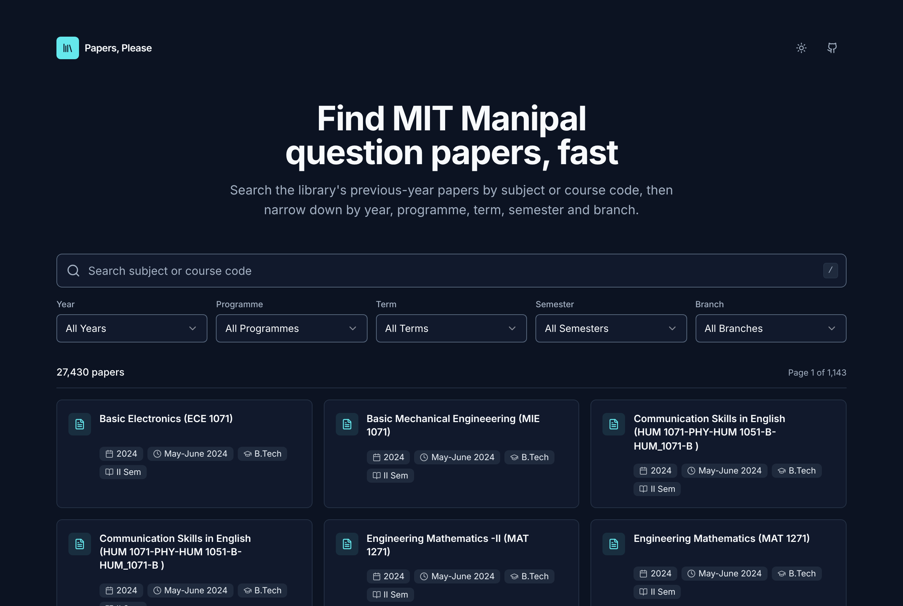
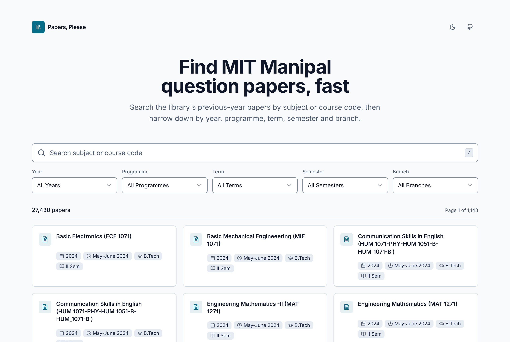
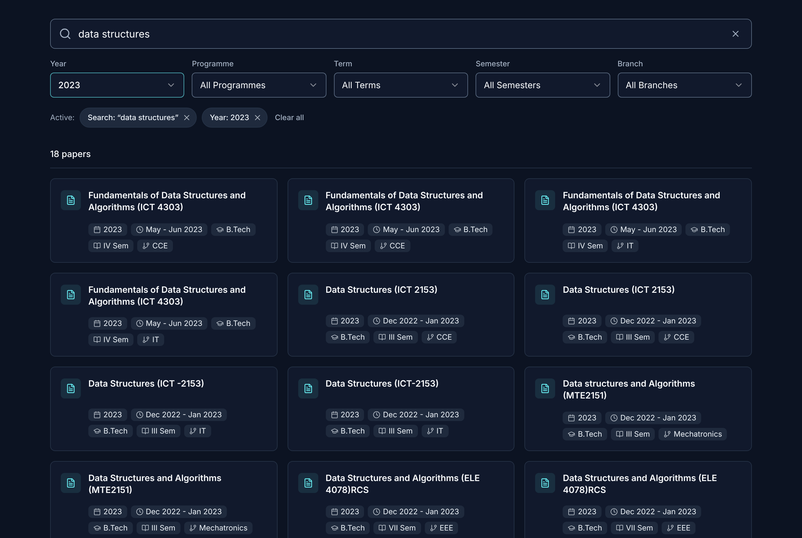
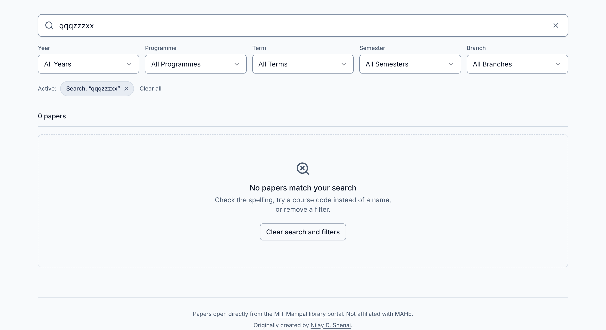
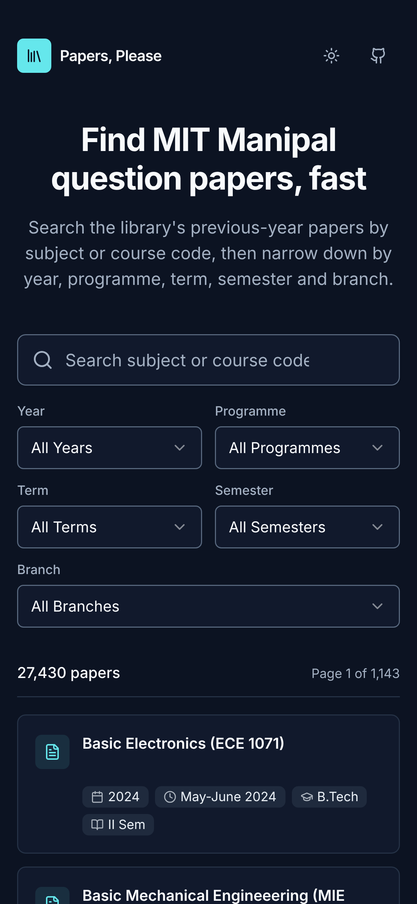
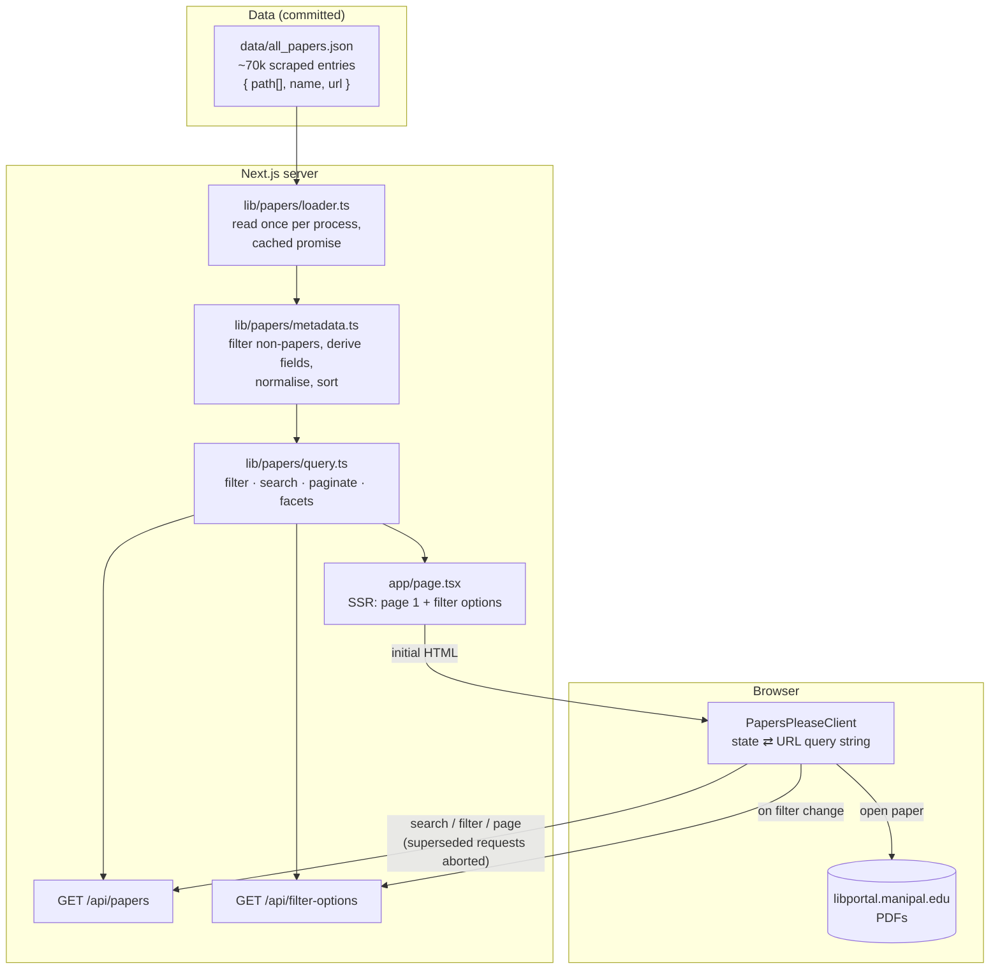

# Papers, Please


**Search and filter MIT Manipal's previous-year question papers from one fast page.**

## Overview

MIT Manipal's library portal hosts tens of thousands of past question papers, organised as a deep tree of folders: year → term → programme → semester → branch → PDF. Folder names are inconsistent from year to year (`Computer Science`, `CSE`, `computer science engg`, …), there is no search, and finding one paper means a lot of clicking.

Papers, Please takes a scraped index of that portal, cleans it into structured records and puts them behind a single search box with cascading filters. Every result links straight to the original PDF on the library portal; no papers are re-hosted.

It is built for students preparing for exams who want a specific paper (or every paper for a subject) quickly, and for developers who want the same data through a small JSON API.

## Screenshots

All screenshots were captured from the running app with the dataset in this repository.

| Dark theme (default when the OS prefers dark)                                                                  | Light theme                                                  |
| -------------------------------------------------------------------------------------------------------------- | ------------------------------------------------------------ |
|  |  |

| Search plus a filter, with removable chips                                                                    | No results                                                                           | Phone (390 px)                                                               |
| ------------------------------------------------------------------------------------------------------------- | ------------------------------------------------------------------------------------ | ---------------------------------------------------------------------------- |
|  |  |  |

## Features

**Finding papers**

- **Instant search** over paper names, inferred subjects and course codes (e.g. `data structures`, `MAT 1271`), debounced as you type.
- **Cascading filters** for year, programme, term, semester and branch. Each dropdown only lists values that still have results given your other choices, and changing a filter clears the narrower ones below it.
- **Active-filter chips**: each one removes a single filter, and _Clear all_ resets everything.
- **Shareable URLs**: search, filters and page are kept in the query string (`/?q=data+structures&year=2023&page=2`), so a view can be bookmarked or sent to a friend. A page number past the end of the results jumps to the last page.
- **Pagination** with first/previous/next/last controls, 24 papers per page.
- **Sensible ordering**: newest year first, then term, programme, semester (numerically, so II comes before IV) and branch.

**Experience**

- Light and dark themes. The default follows the operating system, the choice is remembered, and there is no flash of the wrong theme on load.
- Responsive from phones to wide desktops (checked at 375, 768 and 1280 px), with 40 px or larger touch targets on controls.
- Keyboard friendly: press `/` to jump to search and `Esc` to clear it. There is a skip link, visible focus rings and a logical tab order.
- Screen-reader support: labelled controls, a live results count, and a pagination landmark with labelled buttons.
- Text and control colours meet WCAG AA contrast in both themes.
- Loading skeletons, an empty state with suggestions, an error state with retry, and a custom 404 page.
- The first page and filter options are rendered on the server, so results are visible before any JavaScript runs.
- Respects `prefers-reduced-motion`.
- Page title, description, Open Graph and Twitter metadata, plus a generated Open Graph image.

**Data cleaning**

- Drops library documents that aren't question papers (policies, membership forms, open-access guides, certificates).
- Derives year, term, programme, semester and branch from the folder path, inferring B.Tech when a semester folder has no programme.
- Normalises branch spellings (e.g. `Computer Science` / `computer science engg` → `CSE`, `E & C` → `ECE`) and keeps acronyms upper-case (`CCE`, `IT`, `VLSI`).
- Strips exam-type words (`End Sem`, `Makeup`, `Exam`, …) and empty brackets from file names, and infers a subject from the text before the course code.

## Tech stack

| Layer            | Technology                                                                                                                                               |
| ---------------- | -------------------------------------------------------------------------------------------------------------------------------------------------------- |
| Framework        | [Next.js 15](https://nextjs.org/) with the App Router and route handlers                                                                                 |
| Language         | TypeScript (strict mode)                                                                                                                                 |
| UI               | React 18, [Tailwind CSS 3](https://tailwindcss.com/), [shadcn/ui](https://ui.shadcn.com/) components on [Radix UI](https://www.radix-ui.com/) primitives |
| Icons and motion | [Lucide](https://lucide.dev/), [Framer Motion](https://www.framer.com/motion/)                                                                           |
| Font             | Inter via `next/font` (self-hosted at build time)                                                                                                        |
| Data             | Static JSON file parsed in memory; no database                                                                                                           |
| Testing          | [Vitest](https://vitest.dev/)                                                                                                                            |
| Code quality     | ESLint 9 (`next/core-web-vitals`, `next/typescript`), Prettier                                                                                           |
| Packaging        | Docker multi-stage build using Next.js standalone output                                                                                                 |

## Architecture



How a request flows:

1. On the first request (or at build time for the static home page), `loader.ts` reads the JSON file and passes it through `processRawPapers`. About 70,000 raw entries become roughly 27,000 papers, sorted and kept in memory for the life of the process.
2. `page.tsx` renders the unfiltered first page and every filter's options on the server.
3. In the browser, `PapersPleaseClient` keeps `{ search, filters, page }` in React state and mirrors it to the URL. Each change calls `/api/papers`, and filter changes also refresh the options from `/api/filter-options`. An `AbortController` cancels any request that has been superseded, so stale responses never overwrite newer ones.
4. All filtering logic lives in pure functions in `src/lib/papers/`, shared by the server page, the API routes and the tests.

## Getting started

### Prerequisites

- **Node.js 20.9 or newer** (`node -v`)
- **npm** (a `package-lock.json` is committed; other package managers work but aren't tested)
- About 200 MB of free disk space for dependencies

### Installation

```bash
# 1. Clone your copy of the repository
git clone https://github.com/<your-user>/<your-fork>.git papers-please
cd papers-please

# 2. Install exact dependency versions from the lockfile
npm ci

# 3. (Optional) Create a local env file; nothing in it is required
cp .env.example .env.local

# 4. Start the dev server
npm run dev
```

Open <http://localhost:3000>.

### Configuration

All variables are optional.

| Variable               | Required | Default                | Description                                                                                                                                                     |
| ---------------------- | -------- | ---------------------- | --------------------------------------------------------------------------------------------------------------------------------------------------------------- |
| `NEXT_PUBLIC_SITE_URL` | No       | _(unset)_              | Public URL of the deployment, e.g. `https://papers.example.com`. Used to build absolute URLs for Open Graph tags. Invalid URLs are ignored. Read at build time. |
| `PAPERS_DATA_FILE`     | No       | `data/all_papers.json` | Path to the dataset, absolute or relative to the working directory. Useful for keeping data outside the image or repository.                                    |
| `PORT`                 | No       | `3000`                 | Port for `npm start`, `node server.js` and the Docker image.                                                                                                    |
| `HOSTNAME`             | No       | `0.0.0.0` in Docker    | Interface the standalone server binds to.                                                                                                                       |

### Running in production

```bash
npm ci
npm run build
npm start
```

`npm run build` also writes a self-contained server to `.next/standalone/` (see [Deployment](#deployment)).

## Usage

### In the browser

1. Type a subject or course code in the search box. Results update as you type, and the URL updates with them.
2. Narrow down with the **Year**, **Programme**, **Term**, **Semester** and **Branch** dropdowns. Options that would give no results are hidden.
3. Remove a single filter with the × on its chip, or click **Clear all**.
4. Click a card to open the PDF on the library portal in a new tab.
5. Copy the address bar to share exactly what you are looking at.

| Shortcut            | Action                          |
| ------------------- | ------------------------------- |
| `/`                 | Focus the search box            |
| `Esc` (in search)   | Clear the search                |
| `Tab` / `Shift+Tab` | Move between controls and cards |

### Through the API

```bash
# Second-year (IV Sem) papers from 2022 mentioning "data", one per page
curl 'http://localhost:3000/api/papers?year=2022&semester=IV%20Sem&search=data&pageSize=1'
```

```json
{
  "total": 22,
  "page": 1,
  "pageSize": 1,
  "totalPages": 22,
  "results": [
    {
      "year": "2022",
      "term": "Jun-Jul 2022",
      "name": "Database Systems (CSE 2251)",
      "programme": "B.Tech",
      "semester": "IV Sem",
      "branch": "CSE",
      "subject": "Database Systems",
      "path": ["2022", "Jun-Jul 2022", "B.Tech", "IV Sem", "CSE"],
      "url": "https://libportal.manipal.edu/RootFolder/2022/Jun-Jul%202022/B.Tech/IV%20Sem/CSE/Database%20Systems%20(CSE%202251)%20(Makeup).pdf",
      "id": "paper-24633"
    }
  ]
}
```

```bash
# Which semesters have papers in 2022?
curl 'http://localhost:3000/api/filter-options?level=semester&year=2022'
# {"options":["I Sem","II Sem","III Sem","IV Sem","V Sem","VI Sem","VII Sem"]}
```

Counts depend on the dataset. Ids are only stable for a given version of `data/all_papers.json`.

## API reference

There is no authentication: the data is public. Both endpoints are `GET`, return JSON and are rendered on demand.

| Method | Path                  | Auth | Description                                                        |
| ------ | --------------------- | ---- | ------------------------------------------------------------------ |
| `GET`  | `/api/papers`         | None | One page of papers matching the filters and search.                |
| `GET`  | `/api/filter-options` | None | Values available for one filter, given the other selected filters. |

### `GET /api/papers`

| Query parameter                                   | Type          | Default | Notes                                                                             |
| ------------------------------------------------- | ------------- | ------- | --------------------------------------------------------------------------------- |
| `year`, `programme`, `term`, `semester`, `branch` | string        | none    | Exact match. `all` or an empty value means "no filter".                           |
| `search`                                          | string        | none    | Case-insensitive substring match on name or subject. Trimmed, max 200 characters. |
| `page`                                            | integer ≥ 1   | `1`     | Invalid values fall back to `1`.                                                  |
| `pageSize`                                        | integer 1–100 | `24`    | Values above 100 are capped.                                                      |

**200** → `{ total, page, pageSize, totalPages, results: Paper[] }`. `totalPages` is at least 1. A page past the end returns an empty `results` array.

**500** → `{ "error": "Failed to load papers." }` if the dataset can't be read. Details are logged on the server only.

### `GET /api/filter-options`

| Query parameter                                   | Type                                                      | Notes                                                                                    |
| ------------------------------------------------- | --------------------------------------------------------- | ---------------------------------------------------------------------------------------- |
| `level`                                           | `year` \| `programme` \| `term` \| `semester` \| `branch` | Required.                                                                                |
| `year`, `programme`, `term`, `semester`, `branch` | string                                                    | Current selections. The `level`'s own selection is ignored, so siblings stay selectable. |

**200** → `{ "options": string[] }`, in display order (years newest first, semesters numerically).
**400** → missing or unknown `level`.
**500** → dataset unavailable.

### `Paper` object

| Field                                        | Type     | Description                                    |
| -------------------------------------------- | -------- | ---------------------------------------------- |
| `id`                                         | string   | Unique within a dataset version (`paper-<n>`). |
| `name`                                       | string   | Cleaned display name.                          |
| `url`                                        | string   | Direct link to the PDF on the library portal.  |
| `year`, `term`                               | string   | Always present.                                |
| `programme`, `semester`, `branch`, `subject` | string?  | Present when they could be inferred.           |
| `path`                                       | string[] | Original folder path on the portal.            |

## Scripts

| Command                | Description                                                                 |
| ---------------------- | --------------------------------------------------------------------------- |
| `npm run dev`          | Dev server with hot reload (Turbopack).                                     |
| `npm run build`        | Production build, including the standalone server in `.next/standalone`.    |
| `npm start`            | Serve the production build.                                                 |
| `npm test`             | Run the test suite once.                                                    |
| `npm run test:watch`   | Run tests in watch mode.                                                    |
| `npm run lint`         | ESLint.                                                                     |
| `npm run format`       | Format all files with Prettier.                                             |
| `npm run format:check` | Check formatting without writing.                                           |
| `npm run typecheck`    | `tsc --noEmit`.                                                             |
| `npm run check`        | Lint, format check, typecheck and tests together (run before opening a PR). |

## Testing

```bash
npm test
```

The Vitest suite (`tests/`) runs in Node against a small fixture dataset (`tests/fixtures/papers.json`) and covers:

| File                | What it checks                                                                                                                                                   |
| ------------------- | ---------------------------------------------------------------------------------------------------------------------------------------------------------------- |
| `metadata.test.ts`  | Branch normalisation and acronyms, name cleaning, subject inference, path parsing, the non-paper filter (including non-http URLs), id assignment and sort order. |
| `sort.test.ts`      | Term, semester and programme ordering, and option sorting.                                                                                                       |
| `query.test.ts`     | Query-string parsing with malformed input, AND filtering, search, pagination, faceted options, the filter cascade and client request building.                   |
| `url-state.test.ts` | Shareable-URL round-trip, defaults and malformed input.                                                                                                          |
| `api.test.ts`       | Both route handlers end to end: success, validation errors and parameter fallbacks.                                                                              |

The UI flows (search, filtering, chips, URL restore, pagination, theme toggle, empty, error and 404 states, keyboard navigation, and layout at 375, 768 and 1280 px) were checked by hand in a headless browser. There is no automated end-to-end suite yet (see the roadmap).

## Linting and formatting

- **ESLint** uses `eslint.config.mjs` (flat config) with Next.js' Core Web Vitals and TypeScript rules, plus `consistent-type-imports`.
- **Prettier** uses `.prettierrc.json`: single quotes, trailing commas, 100-character lines. `data/` and the lockfile are ignored.

```bash
npm run lint
npm run format
```

## Deployment

### Docker

The `Dockerfile` installs with `npm ci`, builds, then copies only the standalone server, static assets, `public/` and `data/` into a slim `node:20-alpine` image that runs as a non-root user.

```bash
docker build -t papers-please .
docker run --rm -p 3000:3000 papers-please
# with a custom site URL for Open Graph tags (build-time):
docker build --build-arg NEXT_PUBLIC_SITE_URL=https://papers.example.com -t papers-please .
```

`NEXT_PUBLIC_SITE_URL` is passed as a build argument because Next.js inlines `NEXT_PUBLIC_*` values at build time. Runtime options (`PORT`, `PAPERS_DATA_FILE`) are set with `docker run -e`.

### Node.js host (VM, PaaS)

```bash
npm ci && npm run build
cp -r .next/static .next/standalone/.next/
cp -r public data .next/standalone/
cd .next/standalone && PORT=3000 node server.js
```

Or just run `npm start` from the project root after building.

### Vercel and other serverless platforms

The app has no special runtime requirements, but the API routes read `data/all_papers.json` from disk at runtime. Make sure the file is included in the deployed function bundle (for example with `outputFileTracingIncludes` in `next.config.ts`), or point `PAPERS_DATA_FILE` at a location the function can read. This setup hasn't been tested.

### Updating the data

Replace `data/all_papers.json` with a new export in the same shape (`[{ "path": string[], "name": string, "url": string }]`) and redeploy or restart. Entries that can't be parsed are skipped, and the totals are logged on startup:

```
[papers] Loaded 27430 papers from …/data/all_papers.json (skipped 42960 entries).
```

## Project structure

```
.
├── data/
│   └── all_papers.json          # Scraped portal index (source of truth, ~19 MB)
├── docs/
│   └── screenshots/             # README screenshots, captured from the running app
├── public/
│   └── favicon.ico
├── src/
│   ├── app/                     # Next.js App Router
│   │   ├── api/
│   │   │   ├── papers/route.ts          # GET /api/papers
│   │   │   └── filter-options/route.ts  # GET /api/filter-options
│   │   ├── layout.tsx           # <html>, font, metadata, theme bootstrap, skip link
│   │   ├── page.tsx             # Home: SSR first page + options
│   │   ├── loading.tsx          # Skeleton while the page streams
│   │   ├── error.tsx            # Error boundary with retry
│   │   ├── not-found.tsx        # 404 page
│   │   ├── opengraph-image.tsx  # Generated social preview image
│   │   └── globals.css          # Design tokens (light/dark), base styles
│   ├── components/
│   │   ├── PapersPleaseClient.tsx   # State, URL sync, data fetching, results
│   │   ├── Filters.tsx              # Five labelled selects
│   │   ├── ActiveFilters.tsx        # Removable chips + "Clear all"
│   │   ├── PaperList.tsx            # Result cards + loading skeleton
│   │   ├── Pagination.tsx           # First / prev / next / last
│   │   ├── SiteHeader.tsx           # Brand bar, hero, footer
│   │   ├── PageShell.tsx            # Shared page layout
│   │   ├── ThemeToggle.tsx          # Light/dark switch
│   │   └── ui/                      # shadcn/ui primitives (button, input, select, …)
│   ├── hooks/useDebounce.ts
│   ├── lib/
│   │   ├── api/client.ts        # Typed fetch helpers for the browser
│   │   ├── papers/
│   │   │   ├── filters.ts       # Filter levels, limits, cascade (shared client/server)
│   │   │   ├── metadata.ts      # Raw entry → Paper (cleaning, normalisation)
│   │   │   ├── query.ts         # Filtering, search, pagination, facets
│   │   │   ├── sort.ts          # Ordering rules
│   │   │   ├── url-state.ts     # State ⇄ query string
│   │   │   └── loader.ts        # Server-only file loading + cache
│   │   ├── theme.ts             # Theme storage key + pre-paint script
│   │   └── utils.ts             # cn() class helper
│   └── types/paper.ts           # RawPaper, Paper
├── tests/                       # Vitest suites, fixture dataset, stubs
├── Dockerfile                   # Multi-stage, non-root, standalone
├── eslint.config.mjs · .prettierrc.json · vitest.config.mts
├── next.config.ts               # Standalone output, security headers
├── tailwind.config.ts           # Theme tokens → Tailwind colours
└── .env.example
```

## Troubleshooting and FAQ

**The page loads but has no styling.**
Make sure `postcss.config.mjs` exists. Tailwind only runs through PostCSS.

**`npm run build` fails fetching the Inter font.**
`next/font/google` downloads the font at build time. Build with internet access, or switch `src/app/layout.tsx` to `next/font/local` with a bundled font file.

**The API returns `500 Failed to load papers.`**
The dataset couldn't be read or parsed. Check the server log; the full error is printed there. Verify that `data/all_papers.json` exists next to the server (Docker and standalone deployments must copy it) or that `PAPERS_DATA_FILE` points to a readable file.

**I updated `data/all_papers.json` but nothing changed.**
The data is parsed once per server process and the home page is prerendered at build time. Rebuild and restart.

**A filter shows odd values like "1 Sem" under Branch, or near-duplicates like "Embedded System" and "Embeded Systems".**
These come straight from inconsistent folder names on the portal. The normaliser handles the most common branches; see [Known limitations](#known-limitations).

**A shared link shows "Page 82 of 82" instead of the page in the URL.**
The link pointed past the last page for those filters, so the app jumped to the last real page.

**Port 3000 is already in use.**
Run `PORT=3001 npm start`, or `npm run dev -- -p 3001` for the dev server.

## Known limitations

- **Data quality depends on the portal's folder names.** About 250 distinct branch labels (253 in the current dataset) remain after normalisation, including typos and semester names in branch position. Programme is inferred as B.Tech whenever a semester folder has no explicit programme, which mislabels some M.Sc and MCA papers.
- **Static snapshot.** The dataset is a committed scrape, so new papers appear only when the file is updated. The scraper itself is not part of this repository.
- **Substring search only.** There is no fuzzy matching or typo tolerance, and no ranking beyond the fixed sort order.
- **Broken links are possible** if the library moves or removes files. Papers aren't mirrored.
- **Memory.** The whole dataset is held in memory (tens of MB per server process). That is fine for this size but won't scale indefinitely.
- **Ids** are positional and change when the dataset changes.

## Roadmap ideas

- Automated end-to-end tests (Playwright) for the main UI flows.
- Fuzzy search (e.g. a small in-memory index) and highlighting of matched terms.
- A curated branch alias table to collapse the remaining spelling variants.
- Stable ids derived from the PDF URL.
- Include the scraper and a scheduled data refresh.
- Group duplicate papers (e.g. the same paper listed under several branches).

## Contributing

1. Fork the repository and create a branch: `git checkout -b feat/my-change`.
2. Install with `npm ci` and make your change, adding or updating tests in `tests/`.
3. Run `npm run check` and `npm run build`. Both must pass.
4. Use [Conventional Commits](https://www.conventionalcommits.org/) (`feat:`, `fix:`, `docs:`, …).
5. Open a pull request describing what changed and how you verified it. Include screenshots for UI changes.

Changes to the parsing rules in `src/lib/papers/metadata.ts` affect every record, so please include a test case for each new rule.

## Credits and license

Papers, Please was created by **[Nilay D. Shenai](https://github.com/NilayShenai)**; see the [original repository](https://github.com/NilayShenai/Papers-Please). The original author also runs a public instance at <https://papers.000196.xyz/> and publishes a [Docker Hub image](https://hub.docker.com/r/nilayshenai/papers-please). Both are maintained upstream and may not match this fork.

Question papers belong to Manipal Academy of Higher Education and are linked from, not hosted by, this project. It is not affiliated with MAHE.

Distributed under the MIT License; see [`LICENSE`](LICENSE). The original copyright notice must be kept in copies and derivatives.
